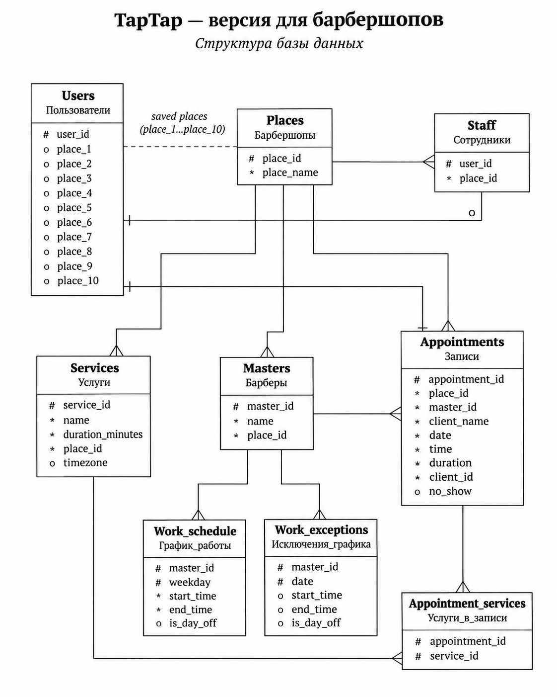

# TapTap — Telegram Mini App для онлайн-записи

**TapTap** — pet-проект сервиса онлайн-записи в барбершопы через Telegram.

В рамках проекта я занимался проектированием реляционной базы данных PostgreSQL и разработкой SQL-запросов для реализации бизнес-логики приложения.

Для разработки и интеграции серверной части на JavaScript использовал ChatGPT.

**Стек:** PostgreSQL, SQL, JavaScript, Node.js, Express, Telegram Mini Apps.

## Проектирование базы данных

Я спроектировал реляционную базу данных PostgreSQL, состоящую из 9 таблиц, для хранения информации о клиентах, заведениях, мастерах, услугах, расписании и записях.

В ходе проектирования:

- Определил основные сущности предметной области и их атрибуты.
- Использовал первичные и составные ключи для идентификации записей.
- Разделил регулярное расписание мастеров (`work_schedule`) и изменения графика на конкретные даты (`work_exceptions`).
- Разработал SQL-запросы для получения данных о мастерах, услугах, свободном времени и клиентских записях.

### ER-диаграмма

*Логическая структура базы данных TapTap.*

## Логика бронирования

Одной из основных задач проекта была организация динамического расчёта свободного времени мастеров.

Для этого система использовала информацию из PostgreSQL:

1. Продолжительность выбранных услуг.
2. Регулярное расписание мастера.
3. Исключения из рабочего графика.
4. Существующие записи клиентов.

На основании этих данных сервер рассчитывал доступные интервалы с шагом 15 минут.

При подтверждении бронирования информация сохранялась в таблицах `appointments` и `appointment_services`.

## Архитектура приложения

Приложение использует клиент-серверную архитектуру:

**Telegram Mini App → Node.js / Express → PostgreSQL**

Сервер взаимодействует с PostgreSQL через библиотеку `pg`, выполняя параметризованные SQL-запросы.

Для разработки серверного JavaScript-кода и интеграции SQL-запросов использовался ChatGPT. Мой основной вклад заключался в проектировании структуры базы данных, подготовке SQL-логики и определении требований к работе приложения.

## Результат

Проект позволил мне получить практический опыт проектирования реляционной базы данных и использования PostgreSQL в реальном прикладном сценарии.

Особенно полезным оказался опыт моделирования связей между сущностями и разработки SQL-запросов, обеспечивающих работу сервиса онлайн-записи.

**Статус:** архивный pet-проект, активная разработка завершена.
